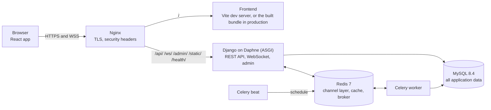
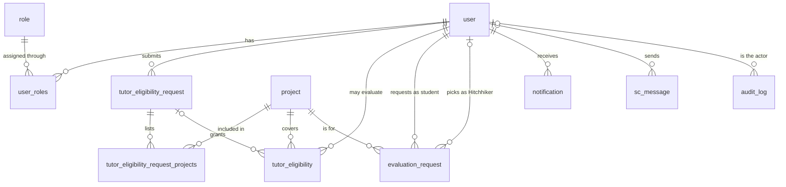

*This project has been created as part of the 42 curriculum by mjusta, rkravche, dkolarov, lhusarov, lformank.*

# 42 Prague Evaluations

## Description

**42 Prague Evaluations** is a web application for the 42 Prague campus that organises the evaluations students get from **Hitchhikers**, the campus tutors. A student asks for an evaluation of a project, an eligible Hitchhiker proposes a time slot, and the student confirms it. Around this workflow the application keeps everyone informed in real time, lets students write anonymously to the **Student Council**, and gives Head Tutors and Administrators the tools to manage who may evaluate what.

Students stay anonymous to Hitchhikers until a Hitchhiker picks their request, and the Hitchhiker stays anonymous to the student until the slot is confirmed, so nobody chooses an evaluator, or a student, by name.

### Key features

- **Evaluation requests:** a student requests an evaluation for one of the campus projects; an eligible Hitchhiker picks it and proposes a slot (15-minute steps, 15–120 minutes, 30 minutes to 14 days ahead); the student accepts or declines; either side can cancel before it starts. Requests nobody picks expire automatically.
- **Eligibility:** a Hitchhiker asks to evaluate a set of projects, and Head Tutors approve or decline the request.
- **Real-time updates and notifications:** a notification center and live updates over WebSockets for every step of a request, role changes and council messages, so pages refresh without reloading.
- **Student Council inbox:** students and Hitchhikers send anonymous messages; council members read them, mark them read or unread and share a discussion note; Administrators can reveal a sender or delete abusive content, with a reason that goes to the audit log.
- **People search:** find Hitchhikers and Student Council members by name, role and project, from the top bar or the Hitchhikers page, and open their public profiles.
- **Roles and workspaces:** Student, Hitchhiker, Head Tutor, Student Council and Administrator, each with its own workspace; the server checks the permissions on every request.
- **Administration:** user accounts (suspend, reactivate, delete), evaluation exceptions and an audit log of sensitive actions.
- **Accounts:** sign in with the 42 intranet (OAuth) or with email and password; a profile with display name and language.
- **Accessibility and languages:** WCAG 2.1 AA (keyboard, screen readers, contrast, reduced motion), English, Czech and Spanish, and support for Chrome, Firefox and Edge.

## Instructions

### Prerequisites

- **Git** to clone the repository.
- **Docker Engine or Docker Desktop**, running and accessible to your user, with the **Docker Compose v2** plugin (`docker compose`). The production override requires Compose **2.24 or newer** with support for the `!reset` and `!override` YAML tags.
- **Make** and a Unix-compatible shell (Linux, macOS, or WSL2 on Windows). The environment setup uses `cp`, `sed` and either **OpenSSL** or **Python 3** to generate secrets.
- A browser: Chrome, Firefox or Edge. For the optional command-line smoke test, install **Bash** and **curl**.
- Internet access for the first build to download images and dependencies, and for signing in through the 42 intranet.

Docker installs the application dependencies inside the containers: Python 3.12, Node.js 20, MySQL 8.4 and Redis 7. You do not need to install them on your host. The local setup uses ports **8080, 4443, 5173, 8000 and 3306**. Nginx is published on host ports **8080** (HTTP) and **4443** (HTTPS), so the stack starts without permission to bind ports 80 and 443. Stop any other services using these ports before starting it.

### Environment variables

From the repository root, run:

```bash
make env
```

This copies `.env.example` to `.env` and generates random values for `DJANGO_SECRET_KEY`, `MYSQL_PASSWORD` and `MYSQL_ROOT_PASSWORD`. It never overwrites an existing `.env`. Open the generated file and review the settings below. Keep `.env` private; it is ignored by Git.

| Variable | Purpose and local configuration |
| --- | --- |
| `DJANGO_SECRET_KEY` | **Secret.** Django's signing key, generated by `make env`. The backend refuses to start if it is empty or still `change-me-in-dev`. |
| `DJANGO_SETTINGS_MODULE` | `config.settings.dev` for local development. `make prod` overrides it with `config.settings.prod` for Django and Celery. |
| `DJANGO_ALLOWED_HOSTS` | Comma-separated hosts Django accepts. Keep `localhost,127.0.0.1,backend` locally; `backend` is used by internal health checks. |
| `MYSQL_DATABASE` | Application database name; default `transcendence`. |
| `MYSQL_USER` | Application database user; default `transcendence`. |
| `MYSQL_PASSWORD` | **Secret.** Application database password, generated by `make env`. |
| `MYSQL_ROOT_PASSWORD` | **Secret.** MySQL root password, generated by `make env`. |
| `MYSQL_HOST` | Database hostname; `db` in Docker Compose. Compose explicitly sets this for the backend and Celery. |
| `MYSQL_PORT` | Database port; `3306`. |
| `REDIS_URL` | Redis connection URL for caching, WebSockets and Celery. Compose explicitly sets `redis://redis:6379/0`. |
| `VITE_API_BASE_URL` | Present in the example as `http://localhost:8000`, but currently unused by the frontend. The API client sends relative requests through the same HTTPS origin. |
| `FT_OAUTH_CLIENT_ID` | UID of your 42 OAuth application. Replace `YOUR_42_APPLICATION_UID` to enable 42 sign-in. |
| `FT_OAUTH_CLIENT_SECRET` | **Secret.** Secret of that 42 OAuth application. Replace `YOUR_42_APPLICATION_SECRET` to enable 42 sign-in. |
| `FT_OAUTH_REDIRECT_URI` | OAuth callback URL. Locally use `https://localhost:4443/api/v1/auth/42/callback/`, exactly matching the redirect URI registered for your 42 application. |

For 42 sign-in, create or configure an OAuth application in the 42 intranet, register the callback above, and copy its UID and secret into `.env`. Email-and-password registration and login can be used without configuring 42 OAuth.

The backend also accepts optional `CELERY_BROKER_URL` and `CELERY_RESULT_BACKEND` overrides; both default to `REDIS_URL` and are unnecessary for the standard setup.

If you already have an older `.env`, `make env` will leave it alone. Replace placeholder secrets yourself; `openssl rand -hex 32` generates a suitable random value. MySQL credentials initialise a **new** database volume: changing them in `.env` does not change passwords in an existing database. Keep the original credentials or update the database account before restarting. After editing `.env`, restart with `make up` (or `make prod` for that profile).

### Running the project

1. Clone the repository and enter its root directory:

   ```bash
   git clone https://github.com/Aztaban/ft_transcendence.git
   cd ft_transcendence
   ```

2. Run `make env` and configure `.env` as described above.

3. Build and start the development stack:

   ```bash
   make up
   ```

   This runs `docker compose up --build` in the foreground. It also runs `make env` if `.env` is missing. On first startup, Docker downloads dependencies and initialises MySQL. The backend applies migrations automatically, including the seeded roles and campus projects. Wait for the backend to become healthy and nginx to start.

4. Open **https://localhost:4443**. Nginx generates a self-signed certificate on first startup; accept your browser's certificate warning for this local instance. Use this HTTPS address for the application and login: session and CSRF cookies require HTTPS, including in development. Plain HTTP on **http://localhost:8080** redirects to that address.

5. Register an account with email and password, or sign in through 42 after configuring OAuth. A new account starts with the Student role. Team members manage additional roles and tutor eligibility through the appropriate workspaces or Django admin.

6. In another terminal, check the running services:

   ```bash
   docker compose ps
   curl -k https://localhost:4443/health/
   scripts/smoke-test.sh
   ```

   The health endpoint reports MySQL (`db`), Redis and the Celery heartbeat. Once the worker and scheduler are running, the expected response is:

   ```json
   {"status": "ok", "db": "ok", "redis": "ok", "celery": "ok"}
   ```

   Celery may briefly report `no heartbeat yet` during startup; the smoke test waits for it. The `-k` option allows curl to use the local self-signed certificate.

The stack contains seven services:

| Service | Local address | Purpose |
| --- | --- | --- |
| `nginx` | **https://localhost:4443** | Application entry point. Host port 8080 is HTTP and redirects to HTTPS on port 4443. Inside the container Nginx still listens on 80 and 443. |
| `frontend` | http://localhost:5173 | Vite development server with live reload. |
| `backend` | http://localhost:8000 | Django development server with live reload; direct access is for debugging. |
| `db` | `127.0.0.1:3306` | MySQL; host access is restricted to this machine. |
| `redis` | Internal only, `redis:6379` | Cache, WebSocket messaging and Celery broker. |
| `celery_worker` | Internal only | Runs background tasks. |
| `celery_beat` | Internal only | Schedules expiry, cleanup and heartbeat tasks. |

Useful commands, run from the repository root:

```bash
make logs       # follow service logs in another terminal
make down       # stop and remove containers; named volumes keep the data
make up         # rebuild and start again
make build      # build images without starting services
```

If startup fails, inspect `docker compose ps` and `docker compose logs backend db nginx`. Check for occupied ports, missing secrets or database credentials that no longer match the saved volume.

### Production profile

Stop the development stack before switching profiles:

```bash
make down
make prod
```

`make prod` layers `docker-compose.prod.yml` over the base file. Django runs under Daphne with `DEBUG` disabled, applies migrations and collects static files on startup. The frontend container builds the static bundle and exits successfully; nginx then serves that bundle and Django's static assets. Source code is baked into the images instead of mounted for live reload.

The application still opens at **https://localhost:4443**. In another terminal, verify it with:

```bash
scripts/smoke-test.sh prod
```

Stop this profile with `make prod-down`. Both profiles share the database and certificate volumes. For a deployment on a different hostname, configure `DJANGO_ALLOWED_HOSTS`, the OAuth callback and a certificate for that hostname; the included nginx setup generates a certificate for localhost.

### Recording evaluation results

Evaluation results are entered manually by the team in **Django admin**, following [api-plan §7.1](docs/api-plan.md#71-evaluation-request-lifecycle) and [database schema §4](docs/database-schema.md). The application API reads these results.

1. With the stack running, create a team account for Django admin if you do not have one:

   ```bash
   docker compose exec backend python manage.py createsuperuser
   ```

   Follow the prompts for email, display name and password. Django admin access requires `is_staff` and the relevant Django permissions; this superuser has both. The application's `admin` role is separate: assigning it does not grant Django admin access, and creating a superuser does not assign that application role.

2. Open **https://localhost:4443/admin/** and sign in with the team account.
3. Open **Evaluations → Evaluation requests**. Use the status, result and project filters or search by the student's email, Hitchhiker's email or project name. Verify the request ID and participants before editing.
4. Check that the request is **confirmed** and its **end time has passed**. The form rejects result entries otherwise. Lifecycle fields such as status and slot times are read-only here.
5. Set **Result** to **Passed** (`passed`) or **Failed** (`failed`), enter the evaluation **Feedback**, and fill in **Completed at** with the actual completion date and time. Django admin uses **UTC**; convert local time before entering it. The application displays times in each user's local timezone.
6. Click **Save**, reopen the record to verify all three fields, and check the evaluation detail in the application. The status stays `confirmed`; ended evaluations appear in History. The first result entry notifies the student and Hitchhiker, and live updates prompt their pages to refresh.

If the form says the evaluation changed since it was loaded, reload it, review the current values and enter the intended changes again. This prevents overwriting another team member's update. Corrections use the same form; changing an existing result does not send another first-result notification.

## Team Information

| Member | 42 login | GitHub | Role |
|---|---|---|---|
| Martin | mjusta | @Aztaban | Product Owner, developer |
| Roman | rkravche | @webxxcom | IT Architect, developer |
| Diana | dkolarov | @dkolarova | Scrum Master, developer |
| Lenka | lhusarov | @Lenka1234 | Developer |
| Lada | lformank | @lformank | Developer |

- **Product Owner (Martin):** the product vision and priorities, the MVP scope, the user workflows and their acceptance criteria, and the product justification of each module.
- **IT Architect (Roman):** the system architecture and technology choices, the data model, the API contract, authentication and authorization, the real-time design and security.
- **Scrum Master (Diana):** the delivery process: the milestones, organising the issues, the meetings, tracking blockers and risks, and keeping the team up to date on the progress.
- **Developers (all of us):** implementation, tests, code review and technical documentation, following the product and architecture decisions we agreed on.

## Project Management

**Organising the work.** We split the project into ten milestones, from the foundation to the final polish:

| Milestone | Scope |
|---|---|
| M1 | Project foundation and infrastructure |
| M2 | Authentication and user management |
| M3 | Core evaluation system |
| M4 | Real-time system |
| M5 | Communication and notifications |
| M6 | Search and discovery |
| M7 | Accessibility and internationalization |
| M8 | Security and administration |
| M9 | Testing and deployment |
| M10 | Final polish and demo |

Each milestone holds parent issues, broken down into small sub-issues with one owner each. Every sub-issue is built on its own branch (`issue-<parent>/<sub-issue>-<description>`) and reaches `main` through a pull request that at least one other member reviews; `main` is protected and only receives reviewed, squash merged pull requests. Over the project we closed more than 460 issues and merged more than 300 pull requests.

**The contract first.** Before a feature was built, its API (`docs/api-plan.md`) and its tables (`docs/database-schema.md`) were agreed and written down, so the frontend and the backend could be built in parallel against the same contract. Decisions are recorded in `docs/decisions.md`, risks in `docs/risks.md`, and the rules every contributor follows in `CONTRIBUTING.md` and `AGENTS.md`.

**Quality checks.** GitHub Actions runs on every pull request: the backend's lint, formatting and tests; the frontend's formatting, type checking and tests; and a Docker build with an end-to-end smoke test through nginx, for both the development and the production setup.

**Meetings.** We met about once a week: at school at the beginning, then online. In the meetings we planned the next milestone and split its issues, went through the progress and the open pull requests, solved blockers and made the decisions that needed the whole team.

**Tools and communication.**
- **GitHub:** issues and sub-issues, milestones, labels, pull requests and reviews, and GitHub Actions for CI.
- **Figma:** the design of the pages before they were built.
- **Slack:** day-to-day communication, questions and review requests.
- **Google Meet:** our online meetings.

## Technical Stack

| Layer | Technology | Why |
|---|---|---|
| Frontend | React 18, TypeScript 5, Vite 5 | React is one of the frameworks the subject names. TypeScript catches a wrong API field at compile time. Vite reloads instantly in development and builds a static bundle for production. |
| Routing and languages | React Router 7, i18next with react-i18next | Client-side routes for each role's workspace; English, Czech and Spanish with plural forms. |
| Styling | Plain CSS with design tokens (`frontend/src/styles/`) | The custom design system is our own components and tokens, not a UI library. |
| Backend | Python 3.12, Django 5.1, Django REST Framework 3.15 | Django brings sessions, password hashing, the ORM, migrations, translations and an admin panel. DRF adds serializers, permission classes and rate limiting. |
| Real time | Django Channels 4 on Daphne (ASGI), channels-redis | WebSockets in the same Django code, authenticated with the same session cookie as the REST API. |
| Background jobs | Celery 5.4 with beat | Work no user triggers such as expiring requests every 5 minutes, deleting old notifications and sessions every day. |
| Database | MySQL 8.4 LTS, InnoDB, `utf8mb4` | See below. |
| Cache and broker | Redis 7 | One service for the WebSocket channel layer, the rate-limit counters and the Celery broker. |
| API schema | drf-spectacular | The OpenAPI schema and Swagger UI, generated from the serializers. |
| Passwords | Argon2 (`argon2-cffi`) | Salted and memory-hard, so stolen hashes are slow to crack. |
| Reverse proxy | Nginx 1.27 | TLS, security headers, and one HTTPS origin for the app, the API, the WebSocket and the admin. |
| Deployment | Docker Compose, Make | The whole stack starts with one command, `make up`; `make prod` runs the production profile. |
| Tests and CI | pytest with pytest-django, Vitest with Testing Library and axe-core, GitHub Actions | Every pull request runs the linters, both test suites, the schema validation and a smoke test of the running stack. |

**Why MySQL.** It is the database our IT Architect knew best, which mattered for designing constraints and debugging locks in the time we had. InnoDB gives transactions and row locks, and check constraints keep each evaluation request's fields consistent with its status. 8.4 is the long-term support release, Django supports MySQL as a first-class backend, and `utf8mb4` stores any text, emoji included.

**The major choices.** Each one is explained in plain language in [docs/decisions.md](docs/decisions.md).

- **A framework on both sides.** React and Django are both named by the subject, and Django's built-in login, password hashing and database layer meant we did not write our own.
- **Sessions, not tokens.** The session cookie is `HttpOnly`, so JavaScript never sees it, and roles are read from the database on every request: a removed role or a suspended account takes effect on the very next request, with no token that stays valid until it expires. The price is CSRF protection, so every unsafe request carries an `X-CSRFToken` header.
- **The contract before the code.** Every endpoint, response shape and error code was written in [docs/api-plan.md](docs/api-plan.md) before it was built, so the frontend and the backend could be built in parallel, and backend tests compare whole response bodies against it.
- **The database is the truth, the WebSocket is only speed.** An event only says what changed; the page then re-fetches it over REST. A lost or late event can delay a page, but never show it wrong data.
- **One Docker Compose stack.** The same services in development and production, started with one command, as the subject requires.

### Architecture



- **One entry point.** The browser talks only to Nginx over HTTPS. Nginx sends `/api/`, `/ws/`, `/admin/`, `/static/` and `/health/` to Django and everything else to the frontend. In production it serves the built frontend itself.
- **The frontend holds no rules.** It renders pages and calls the API through one client, `apiRequest`, which adds the CSRF header and `Accept-Language`. Hiding a button is a convenience; the server checks the user's real roles on every request.
- **The backend is one Django app per area:** `accounts` (users, roles, login, 42 OAuth), `evaluations` (projects, eligibility, evaluation requests), `notifications`, `council` and `audit`. `core` holds what they share: the base model, the error envelope, pagination and the WebSocket consumer.
- **HTTP is the source of truth.** WebSocket messages are `{event, data}` with ids only, sent after the database commit (`transaction.on_commit`), so a rolled-back change never reaches a browser. The page then re-fetches over REST.
- **Concurrent actions.** Shared rows change through one conditional update, `filter(pk=…, status=expected).update(…)`, and the row count says who won. When two Hitchhikers pick the same request at the same moment, one gets it and the other gets 409.
- **Background work.** Celery beat schedules the jobs and the worker runs them: expiry every 5 minutes, deleting notifications older than 90 days and expired sessions every day, and a heartbeat every 10 seconds that `/health/` reports. Expiry pushes its WebSocket events through Redis like the API does.

More detail: [docs/architecture.md](docs/architecture.md), [docs/security.md](docs/security.md) (what is protected and how) and [docs/decisions.md](docs/decisions.md).

### API

The API contract is [docs/api-plan.md](docs/api-plan.md). It is the source of truth: when the code and the document disagree, the document wins and the code is fixed. There are 49 endpoints in 8 areas ([§6](docs/api-plan.md#6-endpoint-summary)). Where to look:

| Looking for | Section |
|---|---|
| URLs, JSON, dates, login and CSRF | [§5.1–5.4](docs/api-plan.md#5-conventions) |
| The error format and every error code | [§5.5](docs/api-plan.md#55-errors), [§5.6](docs/api-plan.md#56-error-codes) |
| Pagination, filters and sorting | [§5.7](docs/api-plan.md#57-lists-pagination-filtering-sorting) |
| Who may do what | [§5.8](docs/api-plan.md#58-roles-and-permissions) and [docs/permissions.md](docs/permissions.md) |
| Rate limits | [§5.9](docs/api-plan.md#59-rate-limits) |
| Workflows: an evaluation request, becoming a Hitchhiker, the council inbox | [§7](docs/api-plan.md#7-workflows) |
| The exact shape of every response | [§8](docs/api-plan.md#8-representations) |
| WebSocket events | [§9](docs/api-plan.md#9-real-time-websocket) |
| Every endpoint, by area | [§10](docs/api-plan.md#10-endpoints) |

With the stack running, **https://localhost/api/schema/** returns the OpenAPI schema generated from the serializers, and **https://localhost/api/docs/** shows it in Swagger UI. CI validates the schema on every pull request. The schema lists fields and types; the contract adds what a schema cannot say: who may call an endpoint, when each error happens and which notifications and events follow.

Reading any endpoint:

- Everything is under `/api/v1/`, and every path ends with `/`.
- Bodies are JSON with `snake_case` fields. Enum values are lowercase (`awaiting_confirmation`, `head_tutor`), and datetimes are ISO 8601 in UTC (`2026-10-12T15:00:00Z`). A nullable field is always present as `null`, a list as `[]`.
- Login sets the `sessionid` cookie. Every `POST`, `PATCH` and `DELETE` sends the `X-CSRFToken` header with the value of the `csrftoken` cookie, which `GET /api/v1/auth/session/` sets.
- No session is 401. Logged in without the right role is 403. Someone else's private object is 404, so its existence is not revealed.
- Lists are paginated with `?page=` and `?page_size=` (20 by default, 100 at most) and return `{count, next, previous, results}`.
- Every error has the same body. The frontend branches on `code`; `message` and `fields` come back in the user's language.

  ```json
  {
    "error": {
      "code": "validation_error",
      "message": "Please correct the highlighted fields.",
      "fields": { "display_name": ["Ensure this field has no more than 64 characters."] }
    }
  }
  ```

## Database Schema

Application data is stored in MySQL 8.4 (InnoDB, `utf8mb4`). Application table names are explicitly defined in the Django models. The diagram below is the whole product schema. Login sessions sit in Django's own `django_session` table and are not part of it. Column-level detail, check constraints and the concurrency rules are in [docs/database-schema.md](docs/database-schema.md).

The database contains 20 tables, including application-specific tables and tables automatically created by Django for authentication, permissions, sessions, and migrations.




`audit_log.actor_id` points at `user`. There is no administrator table, and no extra table per role. The five roles are rows in `role`, linked to a person through `user_roles`. A student or a Hitchhiker never writes an audit row. An administrator writes every kind. A Head Tutor writes eligibility decisions, evaluation overrides and the assignment of the Hitchhiker role. A Student Council member writes only the assignment of another council member. The column is nullable: when that account is removed, the log row stays and `actor_id` becomes NULL.

| Table | Key columns |
| --- | --- |
| `user` | `email` varchar(254) unique, `password` varchar(128), `display_name` varchar(64), `intra_id` bigint unique, `language` varchar(2) (`en`, `cs`, `es`), `status` varchar(16) (`active`, `suspended`, `deleted`) |
| `role` | `name` varchar(254) unique, seeded: `student`, `tutor`, `head_tutor`, `sc_member`, `admin` |
| `user_roles` | `user_id`, `role_id`, unique together |
| `project` | `slug` varchar(64) unique, `name` varchar(128), `is_active` bool |
| `tutor_eligibility_request` | `requester_id`, `status` varchar(16) (`pending`, `approved`, `declined`), `reviewed_by_id`, `reviewed_at` datetime |
| `tutor_eligibility_request_projects` | `request_id`, `project_id`, unique together |
| `tutor_eligibility` | `tutor_id`, `project_id`, unique together; `granted_by_request_id` |
| `evaluation_request` | `student_id`, `project_id`, `status` varchar(32) (`pending`, `awaiting_confirmation`, `confirmed`, `cancelled`, `expired`), `picked_by_id`, `starts_at` and `ends_at` datetime, `result` varchar(16) (`passed`, `failed`) |
| `notification` | `recipient_id`, `type` varchar(64), `payload` json, `read_at` datetime |
| `sc_message` | `sender_id` nullable, `body` text, `read_at` datetime, `discussion_note` text, `discussion_note_version` int |
| `audit_log` | `actor_id`, `action` varchar(64), `target_type` varchar(32), `target_id` bigint, `reason` varchar(500), `metadata` json |

### Django Framework Tables

Additional tables are managed by Django and provide authentication, permissions, session management, administrative logs, and migration tracking.

### How to inspect the database

Connect to the MySQL container:

```bash
docker compose exec db mysql -u root -p
```

Select the application database and list its tables:

```sql
SHOW DATABASES;
USE transcendence;
SHOW TABLES;
```

Inspect the structure and contents of a table:

```sql
DESCRIBE user;
SELECT * FROM user LIMIT 10;
SHOW CREATE TABLE user\G
```

To inspect relationships between tables:

```sql
SELECT
    TABLE_NAME,
    COLUMN_NAME,
    REFERENCED_TABLE_NAME,
    REFERENCED_COLUMN_NAME
FROM information_schema.KEY_COLUMN_USAGE
WHERE TABLE_SCHEMA = 'transcendence'
  AND REFERENCED_TABLE_NAME IS NOT NULL;
```

## Features List

Every feature of the application, with who worked on it. The names come from the merged pull requests: **Backend** is the Django API, **Frontend** the React application. The exact rules of each feature are in `docs/api-plan.md`.

### Accounts and roles

| Feature | What it does | Who |
|---|---|---|
| Registration and login | Create an account with an email, a display name and a password, then log in. The session is a cookie, protected against CSRF. 42 Prague emails must use the 42 login. | Backend: Martin, Roman · Frontend: Diana |
| 42 login (OAuth) | **Continue with 42** creates the account from the 42 profile, or logs in to it. The 42 token never reaches the browser. | Backend: Martin · Frontend: Diana |
| Own profile | Your name, email, roles and how you sign in. You can change your display name and the language. | Backend: Lenka, Roman · Frontend: Diana |
| Public profiles | The profile of a Hitchhiker or a Student Council member: roles, the projects they can evaluate, and your evaluations with them. | Backend: Lenka · Frontend: Diana |
| Roles and workspaces | Five roles: Student, Hitchhiker, Head Tutor, Student Council and Admin. A user can hold several and switches between their workspaces. The server checks the role on every request. | Backend: Lenka, Roman · Frontend: Diana |
| Role management | On a person's profile, a Head Tutor gives the Hitchhiker role, a Student Council member gives Student Council, and an Admin gives and removes Hitchhiker, Head Tutor and Student Council. The change applies at once, and the person is notified. | Backend: Lenka · Frontend: Lada |

### Evaluations

| Feature | What it does | Who |
|---|---|---|
| Projects | The Common Core projects that a Hitchhiker evaluates, each with a details page (topics and what is tested). | Backend: Martin, Roman · Frontend: Diana |
| Becoming a Hitchhiker | A new Hitchhiker chooses the projects they want to evaluate. A Head Tutor approves or declines the whole request, and can later revoke one project. | Backend: Lenka · Frontend: Diana |
| Evaluation requests | A student requests an evaluation for a project, with an optional note. One active request per project. Hitchhikers don't see who asked until they pick it. | Backend: Martin, Roman · Frontend: Diana |
| Slot picking | An eligible Hitchhiker proposes a time slot: 15 to 120 minutes, 30 minutes to 14 days ahead, never overlapping another evaluation of either person. If two Hitchhikers pick the same request at the same moment, only one of them gets it. | Backend: Lenka · Frontend: Diana |
| Confirm or decline | The student accepts the proposed time, or declines it and the request goes back to the queue. The student sees who the Hitchhiker is only after accepting. | Backend: Martin, Roman · Frontend: Diana |
| Cancel and release | The student cancels until the evaluation starts. The Hitchhiker releases the slot, and the request goes back to the queue. | Backend: Martin · Frontend: Diana |
| Expiry | A background job closes requests nobody picked within 14 days, and proposed slots that were not confirmed before they started. | Backend: Martin |
| Dashboards | A Home page for each workspace with what is waiting, plus the upcoming evaluations on the Pending page. | Frontend: Diana, Lada |
| History | Past evaluations and requests with the result and the feedback, filtered by outcome and project. | Frontend: Diana |
| Results | After an evaluation, the team enters the result (passed or failed) and the feedback in the Django admin. | Backend: Martin |

### Real time and notifications

| Feature | What it does | Who |
|---|---|---|
| Live updates | Every open page updates by itself when something changes, over a WebSocket. A notice shows while the connection is lost. | Backend: Martin · Frontend: Diana |
| Notifications | Each step of an evaluation, an eligibility decision or a role change notifies the people it concerns. A bell shows the unread count, and the notification list opens the related page. Read status stays in sync across tabs. | Backend: Martin; links: Lada, Roman · Frontend: Lada |

### Student Council

| Feature | What it does | Who |
|---|---|---|
| Anonymous messages | Anyone can send the Student Council a message. Council members don't see who sent it. | Backend: Lenka · Frontend: Diana |
| Council inbox | Council members read the messages, mark them read or unread and keep an internal note. The history lists every message received. | Backend: Lada, Lenka · Frontend: Diana, Lada |
| Moderation | An Admin deletes a message, or reveals its sender in case of abuse, with a written reason. | Backend: Lenka · Frontend: Diana |

### Search

| Feature | What it does | Who |
|---|---|---|
| People search | Finds Hitchhikers, Head Tutors and Student Council members by name or 42 login (the login itself is never shown), filtered by role and project, sorted by name and split into pages. On the Hitchhikers page and in the top bar. | Backend: Martin · Frontend: Diana |

### Administration

| Feature | What it does | Who |
|---|---|---|
| User management | Admins list, search and edit accounts, suspend and reactivate them, and delete them (the data is anonymized). | Backend: Martin · Frontend: Lada |
| Evaluation exceptions | Head Tutors and Admins see the requests that need a decision: a Hitchhiker who lost the role, a suspended participant, a result still missing after 7 days. They release or cancel the request with a reason (an override). | Backend: Martin · Frontend: Lada |
| Audit log | Role changes, account actions, eligibility decisions, overrides and moderation are recorded with who did them and why. Admins browse and filter the log. | Backend: Lenka · Frontend: Diana |

### Quality of the interface

| Feature | What it does | Who |
|---|---|---|
| Languages | The whole application in English, Czech and Spanish, including the server's messages. | Frontend: Diana · Backend: Lenka |
| Accessibility | WCAG AA contrast, full keyboard use, a skip link, focus kept inside popups, and a title for every page in the browser tab. Checked by automated scans. | Diana |
| Design system | Shared components and colour, type and icon tokens, shown on their own page. | Diana |
| Responsive layout and browsers | Works on phones and tablets, and in Chrome, Firefox and Edge. | Diana |
| Loading, empty and error states | Lists keep their place while loading, say what they will show when empty, and offer **Try again** when loading fails. | Lada |
| Legal pages | Privacy Policy and Terms of Service. | Diana |

### Infrastructure and security

| Feature | What it does | Who |
|---|---|---|
| Docker stack | One command starts MySQL, Redis, Django, Celery, React and Nginx. A production profile serves the built frontend. | Roman · application setup: Martin, Lenka (backend), Diana (frontend) |
| HTTPS and security | Nginx with TLS, security headers, secure cookies and rate limits. | Roman |
| Automated tests | Backend tests (pytest), frontend tests (Vitest and Testing Library), accessibility scans and a smoke test of the running stack. | Roman (CI) · backend tests: everyone, with their feature · frontend tests: Lada, Diana |

### Development workflow

How we work on the code day to day. How the work was organised (milestones, the contract first, reviews, the protected `main`) is in [Project Management](#project-management), and the full rules are in `CONTRIBUTING.md`.

- **Branches.** One branch per sub-issue, from an up-to-date `main`, named `issue-<parent>/<sub-issue>-<short-description>`. Work that needs an unmerged branch is stacked on it, and the stack is merged from the bottom up.
- **Commits.** `<type>: <short summary>`, with the type `feat`, `fix`, `refactor`, `docs`, `test` or `chore`.
- **Pull requests.** The description follows a template: What, Why (`Closes #<issue>`), How to test, Stack context and what is intentionally not included. `CODEOWNERS` requests a reviewer automatically, and the usual pairs are Martin ↔ Lenka for the backend and Diana ↔ Lada for the frontend. Roman reviews architecture changes. A pull request is merged once it has an approval, every review conversation is resolved and the CI is green, and its branch is then deleted.
- **CI** (GitHub Actions) jobs on every pull request:
  - backend: ruff, black and isort, the pytest suite, OpenAPI schema validation and Django's deployment checks
  - frontend: Prettier, the TypeScript check, the Vitest suite and the production build
  - docker: builds the images, starts the stack in the development and the production profile, and runs `scripts/smoke-test.sh` through Nginx

**Running the checks locally** before opening a pull request:

```bash
make test   # backend tests, with the stack running (make up)
(cd backend && ruff check . && black --check . && isort --check .)
(cd backend && python manage.py spectacular --validate --fail-on-warn --file /dev/null)
(cd frontend && npm run format && npx tsc --noEmit && npm test)
```

A frontend test fails when it writes to `console.error` or `console.warn`, because the browser console must stay clean.

## Modules

We chose modules that support the campus evaluation workflow: coordinating students and Hitchhikers, keeping permissions clear, and making the application usable across languages, browsers and access needs. The selection below totals **18 points** against the subject's required 14: **5 Major × 2 + 8 Minor × 1 = 18**. These are the points we aim to demonstrate at evaluation; validation depends on each module meeting the subject's requirements, including acceptance of the two custom modules under §IV.10, "Modules of choice".

| Category | Chosen module | Size | Points |
| --- | --- | --- | ---: |
| Web | Frameworks for both frontend and backend | Major | 2 |
| Web | Real-time features | Major | 2 |
| Web | ORM for the database | Minor | 1 |
| Web | Notification system | Minor | 1 |
| Web | Custom-made design system | Minor | 1 |
| Web | Advanced search with filters, sorting and pagination | Minor | 1 |
| Accessibility and Internationalization | WCAG 2.1 AA accessibility | Major | 2 |
| Accessibility and Internationalization | Multiple languages | Minor | 1 |
| Accessibility and Internationalization | Additional browsers | Minor | 1 |
| User Management | Remote authentication with OAuth 2.0 | Minor | 1 |
| User Management | Advanced permissions system | Major | 2 |
| Modules of choice | Evaluation scheduling | Major | 2 |
| Modules of choice | Audit trail for sensitive actions | Minor | 1 |
| **Total** | **5 Major + 8 Minor** | | **18** |

### Frameworks for both frontend and backend — Major, 2 points

**Why we chose it.** The subject awards this Major for a framework on both sides, instead of the two separate Minors. The application has several workspaces but shares the same accounts, evaluation data and rules. React gives us reusable interfaces, while Django provides authentication, validation and database tools. Using established frameworks on both sides lets the team focus on the evaluation workflow and keep its behaviour consistent as the product grows.

**How it was implemented.**

- **Frontend (Diana):** React 18 with TypeScript, built by Vite and routed with React Router 7 (`frontend/`). Diana initialized the project. Pages are components, shared pieces live in `frontend/src/components/`, and every call to the API goes through one client, `apiRequest`.
- **Backend (Martin):** Django 5.1 with Django REST Framework (`backend/`). Martin initialized the application. The API lives under `/api/v1/`, one Django app per area (`accounts`, `evaluations`, `notifications`, `council`, `audit`). Django REST Framework supplies the views, serializers, permissions and the error handling; Django supplies the ORM, sessions and migrations.

### Real-time features — Major, 2 points

**Why we chose it.** Students and Hitchhikers act on the same requests, often from different browsers. A picked slot, confirmation or cancellation needs to reach the other person promptly, and an open queue should reflect requests that someone else has picked. Live updates reduce manual refreshing and help people act on current information. Reconnection matters because an interrupted connection should not leave a workspace permanently out of date.

**How it was implemented.**

- **Frontend (Diana):** one WebSocket client (`frontend/src/websocket/`) per logged-in tab connects to `wss://…/ws/`, reconnects on its own with a growing delay, and shows "Reconnecting…" and "Back online" in the top bar. Pages subscribe to the events that concern them through a shared hook and, on each event, re-fetch their data over REST instead of trusting the message, so the dashboards, the Hitchhiker queue, Pending, History and the evaluation page update without a reload.

- **Backend (Martin):** Django Channels with Redis. A tab connects to `/ws/` with the session cookie and joins the groups `user_<id>` and `session_<session key>`. A missing or inactive session is accepted and then closed with code 4401. Frames from the client are ignored. `publish_user_event` sends `{event, data}` with ids only, and only after the database commit, so a rollback never reaches a browser. Martin added the evaluation events and `notification.created` / `notification.updated` (api-plan §9.3). Logout sends `session.ended` to that session's tabs and closes them; suspending or deleting an account does the same for every connection of that user. Lenka added `role.changed` and the `notification.updated` sent when an administrator deletes a council message.

### ORM for the database — Minor, 1 point

**Why we chose it.** Users, roles, projects, eligibility and evaluations have related data and constraints. Django's ORM gives the team a shared way to query those relationships and evolve the schema through migrations. Its transaction and locking tools also support the concurrency rules that prevent two Hitchhikers from picking the same request.

**How it was implemented.**

- **Backend (Roman, Martin, Lenka, Lada):** The Django models are the schema, and every change has a migration. Martin added the project setup, `TimeStampedModel` (`created_at` and `updated_at` on the product tables), the `user` model and `notification`. Lenka added `role`, `user_roles` and `audit_log`. Lada added `sc_message`. Roman added `project`, the eligibility tables and `evaluation_request`, including the check constraints that keep a request's pick, cancellation and result consistent with its status. Queries, `select_for_update()` and conditional `update()` all go through this ORM.
- **Frontend:** The browser never uses the ORM. Pages call the API, and only Django reaches MySQL.

### Notification system — Minor, 1 point

**Why we chose it.** A live page update is useful only while someone is looking at that page. Students and Hitchhikers also need a persistent record of actions that concern them, such as a proposed slot, a cancellation or a recorded result. A notification centre lets them catch up when they return and open the relevant information without checking every workspace separately.

**How it was implemented.**

- **Frontend (Lada):** A shared React context loads the unread count from `GET /notifications/unread-count/` once the user is logged in, and the bell in the top bar shows it as a badge. The notification center lists the newest notifications and builds each sentence in the user's language from its `type` and `payload`, so no raw status value is ever shown. Opening a notification marks it as read, and **Mark all as read** clears them all. On the `notification.created` and `notification.updated` WebSocket events, and after a reconnect, the count and the list are fetched again over REST, which keeps every open tab and device in sync. A link switches to the workspace that can open its page, and the backend sends an empty link once the recipient can no longer open the request (R17, Lada with Roman).

- **Backend (Martin, Lenka):** `apps/notifications/` stores one row per recipient: a `type` from api-plan §8.8, a `payload` of facts and a `target_url`. The sentence is not stored. Martin added the model, `create_notification` inside the same transaction as the action, and the `notification.created` event pushed after commit. The owner can list notifications newest first (`unread=true`), read the unread count, mark one or all as read, and delete one. Someone else's notification is 404. Reading and deleting send `notification.updated`. A daily task deletes rows older than 90 days. Lenka added `role.changed` when an administrator changes someone's roles, and deletes the `sc_message.created` notifications in the same transaction when an administrator deletes that council message.

### Custom-made design system — Minor, 1 point

**Why we chose it.** The same forms, dialogs, status labels and loading states appear across several roles. Shared components, colours, typography and icons make those interactions familiar and reduce inconsistent behaviour between pages. They also let us fix accessibility and presentation in one place. This is the subject's listed design-system module, with a minimum of ten reusable components; its reference is [docs/design-system.md](docs/design-system.md).

**How it was implemented.**

- **Frontend (Diana):** design tokens for the palette, typography, spacing and icons (`frontend/src/styles/tokens.css`, with a test that every text colour on its surface reaches 4.5:1), and shared components in `frontend/src/components/ui/`: Button, Input, TextArea, Dialog, Notice, Avatar, StatusPill, Skeleton, EmptyState, Tabs, ProgressBar and Icon. Each component keeps a page's own look when the page passes its class, and every one of them is shown on the `/design-system` page.

- **Backend:** The design system is the palette, type, icons and React components in the browser. The API does not serve it, and `/design-system` is a frontend route, so this module did not change the backend. Its description is in `docs/design-system.md`.

### Advanced search — Minor, 1 point

**Why we chose it.** A student may need a Hitchhiker eligible for a particular project, or someone from the Student Council. Searching names alone does not answer those needs. Role and project filters make the results relevant, sorting makes them predictable, and pagination keeps the list manageable as the campus community grows.

**How it was implemented.**

- **Frontend (Diana):** the Hitchhikers page searches by name (after a short pause, from 2 characters), by role (Hitchhikers, Student Council or everyone), by project and in A–Z or Z–A order, 20 results at a time with "Show more". The filters live in the URL, so a search can be shared or reloaded, and the search box in the top bar opens the same page from anywhere.

- **Backend (Martin):** `GET /api/v1/search/people/` follows api-plan §10.8. Any logged-in user may call it. `q` is optional, 2–64 characters, and matches the display name or the 42 login without regard to case. The 42 login is never in the response. `role` is `tutor`, `head_tutor` or `sc_member`, and `tutor` includes Head Tutors. `project` is a project slug and keeps only Hitchhikers eligible for it. `ordering` is `display_name` or `-display_name`. Only active Hitchhikers, Head Tutors and Student Council members are returned, 20 at a time, each as a public profile plus `eligible_projects`. A student with no such role never appears.

### WCAG 2.1 AA accessibility — Major, 2 points

**Why we chose it.** Requesting and managing an evaluation is part of campus life, so the workflow needs to work for people using a keyboard, screen reader or other assistive tools. Clear structure, readable contrast, labelled controls and predictable focus help people complete the same tasks independently. We chose to address accessibility across the application; the checks and their limits are documented in [docs/accessibility.md](docs/accessibility.md).

**How it was implemented.**

- **Frontend (Diana):** popups take the focus, keep Tab inside and give it back on close; a skip link and keyboard support for the menus; a title for every page and one main heading; landmarks; text contrast raised to AA; reduced motion respected. Checked automatically by axe-core scans of every page and every popup in the tests (`frontend/src/test/`), and by hand with the keyboard only and the Orca screen reader. Results and limits are in `docs/accessibility.md`.

- **Backend:** WCAG applies to the pages a browser renders. The API returns JSON and has no markup, labels or focus, so this module did not change it. Keyboard support, the screen reader, contrast and the axe-core scans are the frontend work above, and the results are in `docs/accessibility.md`.

### Multiple languages — Minor, 1 point

**Why we chose it.** The Prague campus brings together Czech and international students. English, Czech and Spanish make the workflow available to more of that community. Translating validation messages, notifications and status labels as well as page text helps users understand what happened and what action they need to take.

**How it was implemented.**

- **Frontend (Diana):** i18next with English, Czech and Spanish (`frontend/src/i18n/locales/`), including plural forms. Every page, notification text and validation message goes through it, the language switcher works before and after login, the chosen language is saved in the profile, and every API call sends `Accept-Language`, so the backend's messages come back in the same language.

- **Backend (Lenka, Martin):** `LocaleMiddleware` reads `Accept-Language` and the API accepts `en`, `cs` and `es`. A regional tag such as `cs-CZ` still selects Czech. Any other language, or a missing header, falls back to English. User-facing strings are wrapped in `gettext` and translated in `backend/locale`, including the compiled `django.mo` files. The error `code` stays the stable English token the frontend branches on; `message` and `fields` come back in the requested language. A registration test checks the whole error body in each language. Later endpoint messages were added to the same catalogs.

### Additional browsers — Minor, 1 point

**Why we chose it.** Students and tutors use their own computers and should be able to complete an evaluation workflow in their preferred browser. We selected Firefox and Edge alongside Chrome to check that forms, navigation, authentication and live updates behave consistently. Browser checks and known differences are documented in [docs/browser-support.md](docs/browser-support.md).

**How it was implemented.**

- **Frontend (Diana):** a code audit for features that differ between browsers, two fixes (the login form's own validation message instead of the browser's, one search field style everywhere) and later a layout fix found while testing. The whole checklist in `docs/browser-support.md` was run in Firefox 154 and Edge 157: the rows before login by hand, the logged-in rows also automatically in headless Firefox and Edge, with no console errors.

- **Backend:** The API is ordinary HTTPS, JSON, session cookies and WebSockets, so Firefox and Edge call the same endpoints as Chrome. The whole team ran the checklist in `docs/browser-support.md` in all three browsers, including login, 42 sign-in, an evaluation, the council inbox and a live update. That pass required no backend change. The fixes were in the frontend, and the browser-specific limits are written down in the same document.

### Remote authentication with OAuth 2.0 — Minor, 1 point

**Why we chose it.** The intended users already have 42 intranet accounts. Signing in through 42 gives them a familiar entry point and avoids requiring another password for that login method. It authenticates their identity; local roles and approved project eligibility still determine what they may do in this application.

**How it was implemented.**

- **Frontend (Diana):** the "Log in with 42" button on the Login page starts the flow, the app returns to the page the user wanted after the callback, and every error the callback reports is shown as a translated message on the Login page.

- **Backend (Martin):** `GET /api/v1/auth/42/redirect/` stores a random `state` in the session and sends the browser to 42. The callback checks that `state`, exchanges the code for an access token and reads the 42 profile. The token and the client secret stay on the server. A returning user is recognized by `intra_id`, and the login is the same session cookie as a password login. A new 42 user gets a local account with the 42 login as the display name, an unusable password and the `student` role. If that email already belongs to a password account, the callback refuses with `oauth_account_exists` and does not link the two. Success returns the browser to `/`; a failure returns it to `/login?oauth=<code>`.

### Advanced permissions system — Major, 2 points

**Why we chose it.** Students, Hitchhikers, Head Tutors, Student Council members and Administrators have different responsibilities. Permissions protect private requests and council messages, restrict evaluations to eligible Hitchhikers, and reserve role management and moderation for authorised users. Server-side checks are essential because choosing a workspace in the interface must never grant access by itself.

**How it was implemented.**

- **Frontend, user and role management (Lada):** On a person's profile, **Manage roles** offers only what the user's real roles allow: a Head Tutor gives Hitchhiker, a Student Council member gives Student Council, and an Admin gives and removes Hitchhiker, Head Tutor and Student Council. The Admin's user management lists every account with search, role and status filters and pages, edits an account's name, email and language, and suspends, reactivates or deletes it with a reason for the audit log. Head Tutors and Admins see the evaluation exceptions, and release or cancel a request with a reason (an override). These pages call the API only for users who hold the role, so no 403 reaches the browser console, and a 409 (another Admin acted first) is explained and the data loaded again. The server still checks every request.

- **Frontend workspaces (Diana):** the role switcher shows only the workspaces of the user's real roles, each workspace has its own navigation, and a route guard shows the Unauthorized page for a workspace the user does not hold. The active workspace is only interface state: the server checks the real roles on every request.

- **Backend (Lenka, Martin, Lada):** The caller's roles are read from the database on every request. The chosen workspace and Django's `is_staff` grant nothing. `head_tutor` includes every Hitchhiker permission, and `admin` does not include the other roles. Logged out is 401, an endpoint reserved for a role is 403, and a private object is 404. Lenka added these checks and the assignment rules: `student` is given at registration and is never revoked through the API, a Head Tutor or an Admin gives `tutor`, only an Admin gives or removes `head_tutor`, an SC Member or an Admin gives `sc_member`, and `admin` is given only in the Django admin. A Hitchhiker picks a slot only with a `tutor_eligibility` row for that project, and never on their own request. Martin limited each evaluation list to the caller's own requests, the slots they picked and the projects they may evaluate; a Head Tutor or an Admin releases or cancels someone else's request only with a reason. Lada opened the council inbox to SC Members and Admins. Lenka left deleting a message and revealing its sender to Admins: an SC Member gets 403, and anyone else gets 404.

### Evaluation scheduling — Custom Major, 2 points

This is a module of choice (subject IV.10). The listed modules have no booking workflow, and arranging the evaluation is the product, so the claim stands on its own.

**Why we chose it.** Coordinating an evaluation is the central problem this application solves. A student needs an eligible Hitchhiker, a proposed time that works for both people, and a clear confirmation before the evaluation takes place. Keeping the whole process in one workflow makes its current state visible and gives both participants a way to decline, release or cancel a booking.

**Technical challenges.** The scheduler must enforce slot duration, advance notice and time boundaries, prevent overlapping bookings for either participant even when they act in different roles, and handle simultaneous attempts to pick the same request. Confirmation, release, cancellation and automatic expiry must preserve consistent state when actions race. These rules protect participants from double bookings and keep abandoned requests from blocking the queue. The lifecycle and concurrency rules are specified in api-plan §7.1 and database schema §4.

**How it adds value.** The campus problem is not storing a date. It is keeping two people from being booked twice and stopping a request nobody picks from sitting in the queue. Either participant can leave the booking, and a request that was never confirmed expires on its own.

**Why Major (2 points).** The module is a state machine (`pending`, `awaiting_confirmation`, `confirmed`, `cancelled`, `expired`) together with the slot limits, transactions, concurrency protection and a background expiry job across two participants. That is the complexity the two points claim. Live updates about these bookings are the separate real-time module.

**How it was implemented.**

- **Backend (Martin, Lenka):** one `evaluation_request` row is the request, the slot and the later history. Martin built creating a request, listing and filtering it, editing the note, the student's confirm and decline, cancellation, the Hitchhiker's release, and the Celery task `expire_evaluation_requests` (every 5 minutes: a `pending` request older than 14 days, or an unconfirmed slot whose start has passed). Lenka built `POST /api/v1/evaluation-requests/{id}/pick-slot/`: eligibility for that project, no picking one's own request, the slot limits, the overlap checks and the conditional update.
- **Frontend (Diana):** the student's create-request flow, the Hitchhiker queue and the slot picker, confirming or declining a proposed slot, Pending with preview and cancel, and History with filters and pagination.

### Audit trail for sensitive actions — Custom Minor, 1 point

**Why we chose it.** Campus administrators can change roles, suspend accounts, override evaluations and reveal the sender of an anonymous council message. Those actions need a record so the team can investigate a decision and explain who took it, what it affected and why.

**Technical challenges and value.** Audit entries capture the actor, action, target, timestamp, reason and relevant metadata. Recording them within the transaction of the action keeps the history consistent with committed changes. Application-level guards reject edits and deletions of audit entries, while an Administrator-only view supports filtering and pagination. This makes sensitive activity traceable across accounts, eligibility, evaluations and council moderation; the audited actions and response fields are defined in [api-plan §10.9](docs/api-plan.md#109-administration).

**Why Minor.** A shared recording service, protected records and a searchable review interface form a focused feature that supports a one-point claim. Its contribution is accountability after an action: the separately claimed permissions module determines whether that action is allowed. The audit trail preserves evidence for later review.

**How it was implemented.**

- **Frontend (Diana):** the Audit log page in the Admin workspace lists the entries with their actor, action, target, reason and time, with filters and pagination.

- **Backend (Lenka, Martin):** `apps/audit/` writes one append-only row per sensitive action through `record_audit`, in the same transaction as the change. The model rejects a later edit or delete. If the actor's account is removed, `actor_id` becomes NULL and the row stays, because `target_id` is not a foreign key. Lenka added the model, the admin-only list `GET /api/v1/admin/audit-log/` with filters for the actor, the action, the target and the time, and the entries for role changes, eligibility review and revocation, and for deleting a council message or revealing its sender. Martin added the entries for editing, suspending, reactivating and deleting an account, and for a Head Tutor or Admin releasing or cancelling someone else's evaluation.

## Individual Contributions

### Martin (mjusta)

Product Owner and backend developer. I worked on the product definition and implemented backend features for accounts, evaluations, real-time updates, notifications, search and administration, together with the other backend contributors.

- **Product ownership:** drafted the initial project vision, MVP scope, user workflows and role responsibilities, and revised the planning documents after the first team meeting. I worked on the product justification for the chosen modules and documented how they support the campus evaluation workflow.
- **Backend foundation:** helped set up the Django project with Lenka, including settings, the MySQL connection, the REST API structure and Celery integration. I implemented the custom user model, email normalisation and validation, account status handling, password hashing configuration and the initial account migration and tests.
- **Registration and 42 OAuth:** implemented registration validation and the backend 42 OAuth flow, including the callback, provider requests, external identity persistence and local account resolution. Later fixes covered provider response failures, password similarity checks using the display name, and logout succeeding even when WebSocket delivery fails.
- **Evaluation workflow:** implemented project listing and detail endpoints, evaluation request creation, listing, filtering and note editing, student confirmation and decline, student cancellation and Hitchhiker slot release. I added permission, visibility, state-transition and concurrency tests, and later the scheduled expiry of old requests and unanswered slot proposals.
- **Real time (module):** built the backend WebSocket infrastructure with Django Channels and Redis: routing, session authentication, user and session groups, and connection closure when sessions end. I integrated evaluation events and tested delivery to the intended users after database commits.
- **Notifications (module):** implemented the notification model and types, the transactional creation service, list and unread-count APIs, read and delete actions, and retention cleanup. I integrated notifications into evaluation and eligibility workflows and tested updates across the owner's tabs and sessions.
- **Advanced search (module):** implemented the people search API, with matching by display name or 42 login, role and project filters, sorting, pagination and tests. The 42 login can be used for matching without being exposed in the response.
- **Administration and permissions:** implemented user listing, detail and editing, suspension and reactivation, account anonymisation and deletion cleanup, audited evaluation release and cancellation overrides, and the evaluation exceptions list. I strengthened Django admin account rules and manual result entry, including protection against stale result saves.
- **API consistency and tests:** reorganised account views and serializers by responsibility, extracted OAuth services and shared reference serializers, consolidated error and pagination helpers, and improved OpenAPI coverage. My backend tests cover full response shapes, real sessions and CSRF, permission boundaries, rollback behaviour and concurrent actions against MySQL.
- **Documentation:** wrote the README setup instructions, environment-variable reference, production-profile instructions and manual result-recording guide, plus the module justifications and point breakdown.

**Challenges and how I solved them.**

- *Concurrent actions on shared data.* Confirmation, decline, cancellation, account deletion and moderation can affect the same records. I used transactions, conditional updates and a consistent user-lock order, and added concurrency tests to check that competing actions preserve valid state. Manual result saves also compare the version loaded by the form so an older form cannot overwrite a newer edit.
- *Database changes and live updates staying consistent.* A notification or WebSocket message must not describe a change that later rolls back. I kept notification creation in the workflow transaction and deferred WebSocket delivery until commit, with tests for rollback, duplicate actions and multiple connected sessions.
- *Account deletion affecting several workflows.* An account can own requests, hold eligibility, have active sessions and be referenced by notifications. I implemented anonymisation and cleanup around those relationships, preserving started evaluations and closing sessions while handling future requests and slots according to the contract.
- *Keeping the API predictable for the frontend.* Different error formats, inaccurate schemas and inconsistent validation make integration harder. I consolidated shared helpers, corrected OpenAPI descriptions and added regression tests for exact responses and failure cases.

### Roman (rkravche)

IT Architect and developer. I designed the architecture, wrote the API contract and the database schema the team built against, set up the infrastructure, CI and security, and reviewed the team's backend and frontend pull requests (41 merged pull requests of my own, 146 of the team's reviewed).

- **Decisions**. The API contract (`docs/api-plan.md`: endpoints, response shapes, error codes, permissions, notifications and WebSocket events) and the database schema (`docs/database-schema.md`). Also `docs/decisions.md`, the roles matrix `docs/permissions.md`, `docs/security.md` and `AGENTS.md`, the rules every contributor and AI agent follows. Decisions included anonymous pending requests (R15), the Hitchhiker staying anonymous until the student confirms (R18), no file uploads (R19), empty filter values rejected (R20), and what happens to a request already running when a role changes (R21) and when an evaluation has started (R22).
- **Infrastructure.** The Docker Compose stack, Nginx with TLS and a self-signed certificate, the Celery worker and beat, the development tools, migrations on start and the Django admin behind Nginx, `/health/` with the Celery heartbeat, and services that start only when their dependencies are ready, the production profile with Daphne and the built frontend, and a pinned dependency that kept Celery from starting on a fresh build.
- **Security.** rate limits on login, registration and the whole API; JSON-only errors, a random secret key from `make env`, Secure cookies and security headers, written up in `docs/security.md`; random MySQL passwords and the database port on loopback only; the 42 OAuth credentials out of `.env.example`; no password registration with a 42 Prague email, which signs in through 42.
- **Backend.** the models of `project`, the eligibility tables and `evaluation_request`, with the check constraints that keep a request's pick, cancellation and result consistent with its status; the seeded campus projects; editing your own profile, `PATCH /users/me/`; the `evaluation.created` notification opening the pick page; the Hitchhiker's anonymity in responses and notifications.
- **Frontend.** the profile kept in one shared context, so the top bar and the language switcher update after a save; one `useDialog` hook instead of the focus code copied into eight dialogs.
- **CI and code health.** CI checks made required and run once per pull request, a test database that can be created and the frontend test harness, and duplicated code and test fixtures removed.

**Challenges and how I solved them.**

- *A full-time job next to the project.* I could not always answer during the day, so I wrote decisions down instead of giving them only in meetings or chat. The contract, `docs/decisions.md` and `AGENTS.md` answer most questions without waiting for me, and the team kept building.
- *Reviewing both the backend and the frontend.* That was a lot of pull requests. To keep up, the rules a review checks are written down (the contract and `AGENTS.md`), CI does the mechanical part (formatting, types, tests, the schema and a smoke test of the running stack), and Claude Code read each diff against the contract first. I checked what it found before posting it.
- *Setting up a proper architecture.* Five people on one codebase drift apart without shared rules. I fixed one way to do each thing before the features were built: one API client, one error envelope, conditional updates for shared rows, WebSocket events that only point to REST data. `AGENTS.md` records them, so people and AI agents follow the same ones.
- *Finding integration bugs.* Each side's tests passed while the two sides together still failed: a notification linking to a page the frontend did not have, pages asking for data the user could no longer see and logging errors in the console, text colours below the AA contrast. Before the defense I audited `main` with both test suites and a headless browser through every page in every role and language, watching the console, and turned what failed into issues and fixes.
- *Consistent endpoints.* The same question must get the same answer everywhere: filters, errors and status codes. When an endpoint differed, I changed the contract first and the code after it, for example rejecting empty filter values everywhere (R20), defining when an evaluation has started (R22), and fixing the schema's operation IDs and the search errors.

### Diana (dkolarov)

Scrum Master and frontend developer. I set up the frontend and built most of its pages, from the first login form to the final polish (119 merged pull requests).

- **Frontend foundation:** the React + TypeScript + Vite project, routing, the base layout (sidebar, top bar, footer), the API client with the CSRF token, the role-based workspaces and the frontend permission checks, the Unauthorized and 404 pages.
- **Accounts:** registration and login (email and password, 42 OAuth), logout, the session check, the Profile page with editing and settings, and the public profile pages.
- **Evaluation workflow:** the Create Request flow, the student's requests and cancelling them, the Hitchhiker Requests page and slot picking, confirming or declining a proposed slot, the Pending page with preview and cancel, the History with filters and pagination, the evaluation and project detail pages.
- **Dashboards:** the Student and Hitchhiker Home pages with real data, and later the Home redesign with the pixel-art banner; the Profile banner with its own pixel scene.
- **Real time (module):** the WebSocket client with automatic reconnect, the "Reconnecting…" indicator and live refresh of the dashboards, lists and evaluation pages.
- **Eligibility:** the Hitchhiker's eligibility request with the welcome popup, the Head Tutor's review table and the eligibility request detail page.
- **Student Council:** sending an anonymous message, the council inbox, and the Admin's moderation (delete a message, reveal its sender).
- **Search (module):** the Hitchhikers people search page and the top-bar search.
- **Multiple languages (module):** i18next with English, Czech and Spanish, and the translation of every page.
- **Accessibility (module):** WCAG 2.1 AA: focus handling in popups, the skip link and keyboard support for the menus, page titles and headings, landmarks, text contrast; the automated axe-core scans of every page and every popup, and the accessibility report (`docs/accessibility.md`).
- **Design system (module):** the design tokens (palette, typography, icons), the shared components (Dialog, Notice, Avatar, StatusPill, Skeleton, EmptyState, Tabs, TextArea, ProgressBar) and the design system page.
- **Additional browsers (module):** the code audit, the fixes, and the test of the whole checklist in Firefox and Edge (`docs/browser-support.md`).
- **Administration:** the audit log page; responsive layout on phones and tablets, consistent headings and back navigation.
- **Process:** the milestones and issue structure, the repository's contribution workflow (`CONTRIBUTING.md`, CODEOWNERS), the weekly meetings and the team updates.

**Challenges and how I solved them.**
- *A clean browser console.* The subject allows no errors or warnings in the console. Some pages asked the API for things the user could no longer see and logged a 404, and some tests hid warnings. I changed the pages to call the API only when it applies, and the frontend tests now fail on any console error or warning.
- *Live updates without stale screens.* Building state from WebSocket messages risked showing outdated data, so every event only triggers a fresh request over REST, and the client reconnects on its own and shows when it is offline.
- *Big changes across many pull requests.* Translations and the design system touched almost every page. I split them into a stack of small pull requests, one per area, so they could be reviewed one at a time, and rebuilt the branches on `main` whenever a squash merge left them in conflict.
- *Accessibility I could not see myself.* Contrast, focus and screen-reader problems are easy to miss, so I combined automated scans (axe-core in the tests) with manual checks using only the keyboard and the Orca screen reader, and fixed what they found.

### Lenka (lhusarov)

Backend developer, together with Mjusta. I built the server side of profiles and roles, Hitchhiker eligibility, slot picking, the audit log and Student Council moderation.
I also worked closely with Mjusta on code reviews, testing, and getting our changes ready for merging into main.

- **Accounts and roles:** the read-only profile API, role assignment with its ordering and error format, public profile visibility, and the permission checks that decide 401, 403 or 404.
- **Eligibility:** the Hitchhiker onboarding flow on the backend: listing projects, creating an eligibility request, Head Tutor approval or decline, the approved eligibility rows, and the eligibility request detail endpoint. This is the first-time Hitchhiker activation.
- **Evaluation scheduling (module):** `POST /api/v1/evaluation-requests/{id}/pick-slot/`. An eligible Hitchhiker proposes a slot; the endpoint checks project eligibility, blocks picking your own request, enforces the slot length and how far ahead it may be, and rejects overlaps for both people.
- **Audit trail (module):** the append-only audit log (model, migration and admin list with filters). Eligibility reviews, revocations and role changes write an entry, and Student Council moderation (delete a message, reveal its sender) records the reason.
- **Notifications:** a notification when an administrator changes someone's roles, and removal of the related notifications when an administrator deletes a council message.
- **Multiple languages (module):** API messages translated from the `Accept-Language` header into English, Czech and Spanish (`backend/locale`).
- **Database:** utf8mb4 so display names and council messages can store emoji, with a regression test that a name containing an emoji round-trips through MySQL.

**Challenges and what I learned**

- **Learning Django and Django REST Framework.** Most of the backend stack was new to me. I spent a lot of time reading documentation, looking up unfamiliar syntax and concepts, and understanding how models, serializers, views, permissions, and tests work together. As the project progressed, I became more comfortable navigating and modifying the backend.

- **Working with a large, shared codebase.** Features were developed across many small issues and pull requests, which sometimes made it difficult to keep track of the bigger picture. Reading existing code, reviewing pull requests, and discussing implementation details with Mjusta helped me understand how the different parts fit together.

- **Following the API contract.** Implementations had to match the agreed API specification, including permissions, validation, error responses, and status codes. I learned to compare my changes against the API plan and use tests to check that the expected behavior was preserved.

### Lada (lformank)

I joined the frontend work in M3 as Diana's review pair. Most of my work connects the React pages to the API: the notifications, the administration pages, and what every page shows while it loads, when it is empty and after an error. I also wrote the Student Council inbox API and a large part of the frontend tests. Of the modules, I built the frontend of the **Notification system** and the user and role management pages of the **Advanced permissions system**.

**What I built**

- **Notifications (frontend):**
  - the unread count on the bell, the notification center that opens from it, and marking notifications as read
  - live updates of the count and the list over the WebSocket, in every open tab
  - a sentence for every notification type in English, Czech and Spanish
  - links that open the right page in the right workspace
- **Notification links (backend):** an evaluation notification no longer links to a request the recipient can't open any more.
- **A clear error message (backend):** when a project is turned off while a student has the request form open, the student now reads "This project is not available any more." in their language, instead of DRF's `Invalid pk "4"`.
- **Student Council inbox (backend):** sending an anonymous message with its rate limit, plus the inbox list and the message detail for council members, with read/unread and the internal note. On the frontend, the message history page.
- **Administration (frontend):** the Admin user management pages, role management on a person's profile, and the evaluation exceptions page with overrides.
- **Loading, empty and error states** on every page, and the four confirmation popups rebuilt on the shared Dialog.
- **Frontend tests:**
  - tests fail on any console error or warning
  - the form checks and the backend's field messages
  - the shared components
  - user flows for an evaluation and a council message
  - the Home dashboards

**Challenges and what I learned**

- *Working in one repository with the whole team.* Five people changed the same code at once, and my notification work needed Martin's backend before it was merged. I learned to stack branches: each one starts from the branch below, and after a squash merge the next pull request is retargeted to `main`.
- *Live data in several tabs.* Marking a notification as read left the old count in the other tabs. Every tab now re-fetches it over REST on the `notification.updated` event. I learned React context and effects, and that a WebSocket event is only a signal.
- *404s in the browser console.* Notifications linked to evaluations the user could no longer open. The backend now sends an empty link, and I learned Django querysets, serializers and the N+1 problem.
- *Two members editing the same council note.* A conditional update on a version number returns 409 instead of overwriting the other person's text. I learned what a race condition is and why "read, change, `save()`" loses data.
- *Tests that ignored console errors.* Mock resets in about 50 test files hid them, so the test setup now wraps the console methods. I learned how Vitest hooks and mocks work.

## Resources

### References

Documentation the project is built with:

- [Python 3](https://docs.python.org/3/)
- [Django 5.1](https://docs.djangoproject.com/en/5.1/) — models, authentication, migrations, translations
- [Django REST Framework](https://www.django-rest-framework.org/) — serializers, permissions, API views, tests
- [drf-spectacular](https://drf-spectacular.readthedocs.io/) — OpenAPI schema
- [pytest](https://docs.pytest.org/en/stable/)
- [MySQL 8.4](https://dev.mysql.com/doc/refman/8.4/en/)
- [Redis](https://redis.io/docs/latest/)
- [Docker](https://docs.docker.com/) and [Docker Compose](https://docs.docker.com/compose/)
- [Nginx](https://nginx.org/en/docs/)
- [Git](https://git-scm.com/doc)
- [GitHub Docs](https://docs.github.com/) — pull requests, reviews, Actions
- [MDN Web Docs](https://developer.mozilla.org/)
- [React](https://react.dev/)
- [TypeScript](https://www.typescriptlang.org/docs/)
- [Vite](https://vite.dev/guide/)

Day-to-day questions were also answered on [Stack Overflow](https://stackoverflow.com/) and by web search.

Lada:

- React: [state](https://react.dev/learn/state-a-components-memory), [effects](https://react.dev/learn/synchronizing-with-effects) and [context](https://react.dev/learn/passing-data-deeply-with-context): the notification count and the pages' data loading
- [React Router](https://reactrouter.com/): routes and navigation
- [react-i18next](https://react.i18next.com/) and [i18next plurals and context](https://www.i18next.com/translation-function/plurals): the notification sentences
- [Vitest](https://vitest.dev/guide/) and [Testing Library](https://testing-library.com/docs/react-testing-library/intro/): the frontend tests
- Django REST Framework: [permissions](https://www.django-rest-framework.org/api-guide/permissions/) and [throttling](https://www.django-rest-framework.org/api-guide/throttling/): the council inbox
- [Django: updating with `update()` and conditional expressions](https://docs.djangoproject.com/en/5.1/ref/models/querysets/#update): the conditional update of the council note
- [MDN: WebSocket](https://developer.mozilla.org/en-US/docs/Web/API/WebSocket): live notifications
- [WAI-ARIA Authoring Practices: Dialog pattern](https://www.w3.org/WAI/ARIA/apg/patterns/dialog-modal/): the confirmation popups

Roman:

- [Django Channels](https://channels.readthedocs.io/en/stable/): consumers, groups and the Redis channel layer
- [Celery](https://docs.celeryq.dev/en/stable/): the worker and periodic tasks with beat
- [Django deployment checklist](https://docs.djangoproject.com/en/5.1/howto/deployment/checklist/) and [Security in Django](https://docs.djangoproject.com/en/5.1/topics/security/): settings, cookies and CSRF
- [OWASP Cheat Sheet Series](https://cheatsheetseries.owasp.org/): session management, CSRF prevention and HTTP headers
- [MySQL 8.4: InnoDB locking](https://dev.mysql.com/doc/refman/8.4/en/innodb-locking.html) and [Django: `select_for_update()`](https://docs.djangoproject.com/en/5.1/ref/models/querysets/#select-for-update): the concurrency rules
- [42 API documentation](https://api.intra.42.fr/apidoc): the OAuth flow and the user profile
- [Docker Compose: control startup order](https://docs.docker.com/compose/how-tos/startup-order/): health checks and `depends_on`
- [OpenAPI Specification](https://spec.openapis.org/oas/latest.html): the schema format
- [Mermaid](https://mermaid.js.org/): the diagrams in this README

### How AI was used

- **Martin** I used OpenAI Codex to draft tests and do an initial review of my backend changes, including the evaluation workflow, WebSocket updates, and notifications. I reviewed the test drafts and checked that they covered the expected behaviour in our API contract. I went through Codex’s review findings myself and decided which changes to make before submitting my pull requests for peer review.
- **Diana:** I used Claude (Anthropic), through Claude Code in VS Code, as a coding assistant for my frontend work. From the issue and the API contract it drafted code, tests and pull request descriptions; it helped me review teammates' pull requests, find bugs, and run the accessibility and browser checks (axe-core scans, headless browser runs in Firefox and Edge).
- **Lenka:** I used Cursor (mainly Grok). They checked work that had to match the written contract. They drafted and revised tests, helped isolate bugs, and compared endpoints with docs/api-plan.md and other project documentation. I reviewed each suggestion and accepted only changes that I understood, verified, and considered appropriate for the project.
- **Roman:** I used Claude (Anthropic), through Claude Code in VS Code. It read teammates' backend and frontend pull requests against the contract before I reviewed them. I checked what it found and wrote the review comments myself. It ran audits of `main` before the defense (both test suites, and a headless browser through every page in every role and language with the console watched), which became issues and fixes. It helped word the contract documents from my decisions, and drafted code and tests in my pull requests; each pull request description says which parts. The architecture and the contract decisions are mine, and I reviewed every change and can explain it.
- **Lada:** I used Claude (Anthropic), through Claude Code in VS Code, mostly as a tutor. Most of the technologies (React and Django) and issues were new to me, so it explained the concepts and the API contract and gave me step-by-step guides, and I wrote the code myself. Later it also wrote the tests, the code comments, and ran the formatting and type checks, showing me each change with the reason behind it. It helped me review teammates' pull requests with explanation of the topic. Everything was reviewed and understood before applying and merging.

## Known limitations

- **No file uploads.** There are no avatars or attachments; profiles show the person's initials ([R19](docs/api-plan.md#31-resolved)).
- **No email.** There is no password reset or change, no email verification and no email notifications. A team member can set a new password in the Django admin.
- **42 and password accounts are not linked.** If a password account already uses the email of a 42 account, signing in with 42 is refused (`oauth_account_exists`) instead of merging the two.
- **Eligibility and results are manual.** Nothing is synced with the 42 intranet: Head Tutors approve which projects a Hitchhiker may evaluate ([R1](docs/api-plan.md#31-resolved)), and the team enters each result in the Django admin ([Recording evaluation results](#recording-evaluation-results)).
- **Missed live updates are not replayed.** After a reconnect, pages re-fetch what they show. Some shared views have no live event at all (the Head Tutor review table, the council inbox, the evaluation exceptions) and refresh when the browser tab becomes visible again ([api-plan §9.4](docs/api-plan.md#94-disconnects)).
- **The frontend types are written by hand.** `frontend/src/types/` copies the contract and is checked in review. Generating them from the OpenAPI schema and failing CI when they drift is planned, not done ([api-plan §5.10](docs/api-plan.md#510-openapi-schema-and-frontend-types)).
